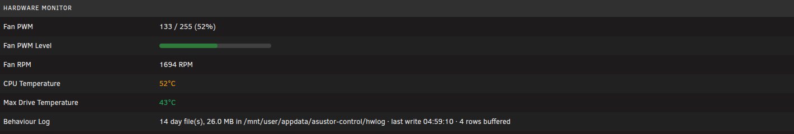
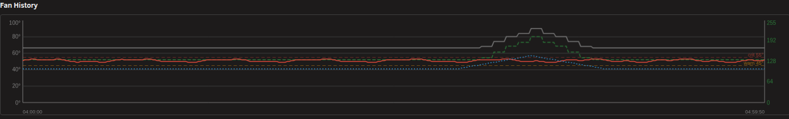
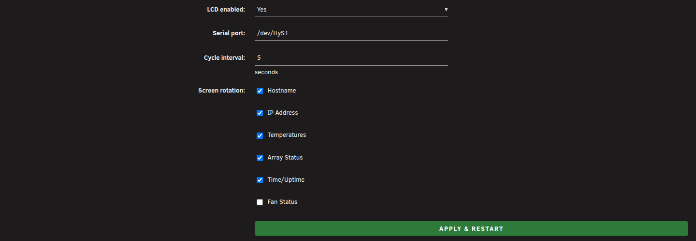
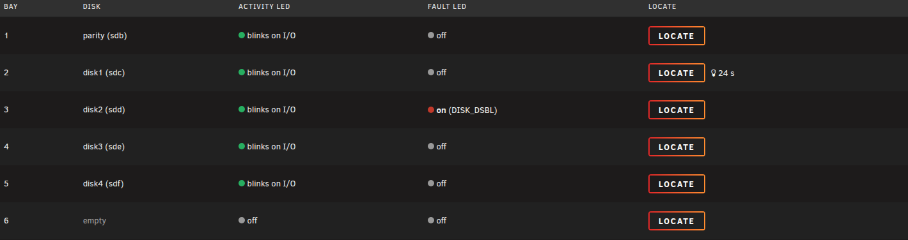

# Asustor Control: an Unraid plugin for Asustor NAS hardware (LCD, front-panel LEDs, monitoring)

This plugin stands on **[mafredri](https://github.com/mafredri)'s Asustor work**: the LCD protocol
([lcm](https://github.com/mafredri/lcm)), the hardware notes
([asustor_as-6xxt](https://github.com/mafredri/asustor_as-6xxt)) and the kernel drivers
([asustor-platform-driver](https://github.com/mafredri/asustor-platform-driver)), which
[Terebi42/unraid-asustor-pfd](https://github.com/Terebi42/unraid-asustor-pfd) builds for every
Unraid kernel. Start there; see [Credits and upstream](#credits-and-upstream).

Asustor Control drives the front-panel LCD and the status LED of an Asustor NAS that runs
Unraid, and shows and logs what the fan, the CPU and the disks are doing. It does not control
the fan: fan control is left to the FanCtrl Plus plugin, and the kernel drivers come from the
Asustor Platform Drivers plugin (see [Requirements](#requirements)).

**Fan control stays with FanCtrl Plus.** This plugin provides the hardware support around it
(drivers watchdog, sensors, logging of what the fan does and why); the aim is to be a compatible
backend for FanCtrl Plus, not a second fan UI. It has no fan curve of its own.

Status: experimental. Developed and tested on one Asustor AS6706T (Lockerstor 6 Gen2,
Intel Celeron N5105, IT8625E Super I/O) under Unraid 6.12 and 7.x, currently Unraid 7.3.4
(kernel 6.18.58-Unraid). Other models are not tested; the hardware report form exists to collect
what other units look like.

## What it does

| | |
|---|---|
| LCD | the 16x2 front-panel LCD on `/dev/ttyS1` (Asustor's serial protocol): rotating screens with hostname, IP address, temperatures, array state, time and fan speed; screens, rotation and port are configurable on the LCD Settings tab, with a live preview |
| Status LED | the green status LED solid on while the plugin runs (IT8625E GP47 through the Super I/O config port); with the LED/button add-on it follows the array (below) |
| Front-panel LEDs (add-on) | per-bay activity (blinks on disk I/O, read from `/sys/block/*/stat`, never wakes a disk) and fault LEDs (Unraid marks the disk disabled/invalid or with read errors); status LED steady = array started, slow blink = parity check/rebuild, fast blink = stopped, red = a disk is disabled/invalid/missing; per-bay **Locate** blink on the LEDs and Buttons tab |
| USB Copy button (add-on) | short/long press actions: log (default), notification, locate, or your own script; there is no built-in shutdown |
| Driver watchdog | when the Asustor kernel drivers are missing (typically after an Unraid update with no matching driver build yet), a red banner on the page, one Unraid notification per boot, an Action Log entry; the monitor waits for the sensor chip instead of exiting |
| Status tab | live fan PWM/RPM, CPU and disk temperatures, a temperature and fan history chart, the action log and the health of the behaviour log; tabs and colours follow the active Unraid theme |
| Behaviour log | `asustor-hwmon` samples every 10 s (PWM, RPM, CPU package/core temperatures, clock, throttle counter, what FanCtrl Plus acted on, NVMe and disk temperatures) to `/mnt/user/appdata/asustor-control/hwlog/`, one CSV per day, 30-day retention; sleeping disks are never woken (temperatures come from Unraid's `disks.ini`) |
| Fan attribution | every PWM change is written to the Action Log with what FanCtrl Plus reacted to and the processes (and Docker containers) that used the most CPU and I/O just before it |
| Offline report | `tools/hwlog-report.py` analyses the behaviour log on a workstation (throttling margin, which drives pull the fan, idle PWM); format in [docs/hwlog-format.md](docs/hwlog-format.md) |

Nothing is written to the fan registers: the plugin only reads hwmon, except for the status LED bit.

## Supported hardware

| Model | State |
|---|---|
| AS6706T (Lockerstor 6 Gen2) | tested: LCD, status LED, monitoring |
| other Lockerstor Gen2 / AS67xx / AS66xx units with an LCD and an IT86xx Super I/O | expected to work (same LCD protocol and Super I/O family), not tested |
| units without an LCD | monitoring and the log work; the LCD daemon finds no display |

### Requirements

- **Asustor Platform Drivers** plugin ([Terebi42/unraid-asustor-pfd](https://github.com/Terebi42/unraid-asustor-pfd)),
  which loads the `asustor`, `asustor_it87` and `asustor_gpio_it87` kernel modules built for the
  running Unraid kernel.
- Optional **LED/button add-on** (LEDs and Buttons tab, Install): Unraid's kernel has no
  `leds-gpio` or `gpio-keys-polled` driver, so the LEDs and buttons the platform driver describes
  have no driver. The add-on installs those two modules plus LED triggers, built from unmodified
  Linux sources with Unraid's own kernel config and compiler (`kmods/`, one package per kernel,
  listed with its MD5 in `kmods.manifest`). It refuses on a kernel it has no build for; without
  it the plugin works as before.
  **Temporary:** the same modules are proposed to the Asustor Platform Drivers plugin
  (https://github.com/Terebi42/unraid-asustor-pfd/pull/1). Until that is merged this repository ships the add-on; once the platform
  driver package provides `leds-gpio` and `gpio_keys_polled` for the running kernel, the add-on
  uses those and does not install its own copy, and new add-on builds stop.
- **FanCtrl Plus** plugin (Community Applications) for fan control. Asustor Control reads its
  state (`/var/tmp/fanctrlplus/`) for the behaviour log; without it the log simply has empty
  FanCtrl columns.

Please use the hardware report form (Issues, New issue, Hardware report) for other models.

### Known limits

- **Front-panel LEDs and buttons need the optional add-on.** The `asustor` module registers them
  as `leds-gpio` and `gpio-keys-polled` platform devices, but the stock Unraid kernel ships
  neither driver, so nothing binds and `/sys/class/leds` stays empty. The add-on (LEDs &amp;
  Buttons tab) supplies both for the Unraid kernels listed in `kmods.manifest`; on any other
  kernel it refuses, the LEDs and Buttons tab says the drivers are missing and the panel keeps
  its firmware state. This is temporary until the Asustor Platform Drivers plugin ships the same
  modules (proposed in https://github.com/Terebi42/unraid-asustor-pfd/pull/1); from then on its copy is preferred.
- The plugin depends on the Asustor Platform Drivers plugin having a build for the running
  Unraid kernel. After an Unraid update without a matching build the modules are missing: the
  LCD, the status LED (direct Super I/O port access), the CPU and drive temperatures keep
  working, but fan PWM/RPM read N/A (they come from the `asustor_it87` hwmon driver). The page
  then shows a red banner, Unraid raises one notification per boot and the Action Log says
  which modules are missing.
- Fan control itself is FanCtrl Plus's job; this plugin only reports what it does.

## Screenshots

Made-up data, one panel each.

Hardware monitor: fan PWM and RPM, CPU and drive temperature, the behaviour log.

Fan history: one hour of fan, CPU and drive temperature.

LCD Settings: port, rotation interval and the screens in the rotation.

LEDs and Buttons: the bay map with activity LED, fault LED and Locate.

## Install

Unraid webGui: **Plugins, Install Plugin**, paste

    https://raw.githubusercontent.com/luuvasara/unraid-asustor-control/main/asustor-control.plg

or on the console: `plugin install https://raw.githubusercontent.com/luuvasara/unraid-asustor-control/main/asustor-control.plg`.

The package (`packages/asustor-control-<version>-x86_64-1.txz`) is downloaded from this
repository and checked against the MD5 in the `.plg`. Updates show up in Unraid's plugin
update check, because the `.plg` carries its `pluginURL`. Settings live on the flash in
`/boot/config/plugins/asustor-control/`; the behaviour log in appdata is kept when the plugin
is removed. The page is under **Utilities, Asustor Control**.

## Build from source

Needs bash, GNU tar, xz, Python 3; PHP (CLI) for the page lint (optional).

    ./tests/run-tests.sh      # offline: script syntax, PHP lint, .plg/package consistency, hwlog-report.py, harness fixtures
    ./tests/render-test.sh     # the four tabs in headless Chrome, all themes (needs Chrome, PHP and network the first time for the stylesheets)
    ./build.sh                # runs kit/bin/build.sh; version comes from asustor-control.plg, bump it on every change

`build.sh` builds `packages/asustor-control-<version>-x86_64-1.txz` (file modes forced, archive
root checked, owner root), writes the package MD5 into the `.plg` and regenerates
`CHANGELOG.md` from the `.plg`'s `<CHANGES>`. Build on a workstation, never on the NAS.

The screenshots come from the render harness: `tests/harness/serve.sh <port>` serves the page
with PHP's built-in server and made-up fixtures (`tests/harness/mkfixture.py`), and
`node tests/harness/shot.cjs http://127.0.0.1:<port> docs/screenshots` captures the three tabs (cropped to one panel each for this README) with
Chrome through playwright-core. Unraid's stylesheets and jQuery are not in this repository; point
`WEBGUI_COPY` at a copy of an Unraid 7.x `webGui/styles` and `JQUERY` at a `jquery.min.js`.

### Repository layout

| path | what |
|---|---|
| `asustor-control.plg` | the plugin manifest (version, pluginURL, package URL + MD5, install/remove scripts, CHANGES) |
| `packages/` | the built package of the version in the `.plg` and its `.md5` |
| `kmods/` | the LED/button driver add-on packages, one per Unraid kernel (listed in `src/.../kmods.manifest`); temporary until the Asustor Platform Drivers plugin ships the same modules |
| `src/` | the package contents, laid out as on the server (`usr/local/emhttp/plugins/asustor-control/`, `usr/local/bin/`, `etc/rc.d/`) |
| `build.sh` | builds the package |
| `tests/` | offline checks (`tests/run-tests.sh`); `tests/harness/` renders the page with made-up data for the screenshots |
| `tools/` | `hwlog-report.py`, offline analysis of the behaviour log |
| `docs/` | `hwlog-format.md`, the behaviour log format; `screenshots/` for this README |
| `CHANGELOG.md` | generated from the `.plg` |
| `.github/ISSUE_TEMPLATE/hardware-report.yml` | the hardware report form |

### How this repository is kept in sync

Development happens in a private repository (it also holds hardware captures and notes that are
not publishable). This repository is an export of the plugin tree; its history starts at the
first export (2026-10-26). Older releases are listed in `CHANGELOG.md`.

## Credits and upstream

- [mafredri/lcm](https://github.com/mafredri/lcm) (MIT) documented the Asustor LCD serial
  protocol; `asustor-lcd` is an independent bash implementation of it.
- [mafredri/asustor_as-6xxt](https://github.com/mafredri/asustor_as-6xxt): notes, LCD logs and
  GPIO findings from running Debian on Asustor hardware.
- [mafredri/asustor-platform-driver](https://github.com/mafredri/asustor-platform-driver) (GPL-3.0):
  the kernel drivers (LEDs, buttons, the patched `it87` hwmon and GPIO drivers) that the Asustor
  Platform Drivers plugin builds and loads; this repository does not redistribute them.
- Linux kernel (GPL-2.0): `kmods/` holds `leds-gpio`, `gpio-keys-polled` and `ledtrig-*` modules
  compiled from the unmodified kernel.org sources of the listed kernel version with Unraid's own
  kernel configuration (shipped by Unraid in `/usr/src/linux-<version>-Unraid/config`); no
  source changes.
- [Terebi42/unraid-asustor-pfd](https://github.com/Terebi42/unraid-asustor-pfd): the Unraid plugin
  that delivers those modules for each Unraid kernel.
- FanCtrl Plus: the fan control this plugin defers to.

Unraid is a trademark of Lime Technology. ASUSTOR, Lockerstor and ADM are trademarks of
ASUSTOR Inc. This project is not affiliated with either.

## License

GPL-2.0, see [LICENSE](LICENSE).
